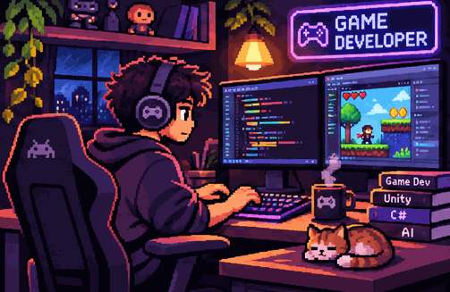

<h1 align="center">Hey, I'm Eaziko 👋</h1>

  

  I build games, experiment with creative software, and enjoy bringing interesting ideas to life.

  

## About me

- 🎮 Game developer who enjoys building interactive experiences.
- 🧪 I also explore web development, embedded hardware, and computer vision through personal projects.
- 🚀 I like learning by making things, especially when an idea sounds fun or challenging.
- 🤝 Open to exciting projects and collaborations when time allows.

## Featured projects

| Project | What it is |
| --- | --- |
| [Lost Object Memory System](https://github.com/Eaziko/Lost-Object-Memory-System) | A camera-based wallet detection prototype using an ESP32-S3-N16R8, OV3660, Flask, and Roboflow. |
| [Star Catcher 2D](https://github.com/Eaziko/Star-Catcher-2D) | A Python and OpenGL arcade game about collecting stars and avoiding asteroids. |
| [LifeSync](https://github.com/Eaziko/LifeSync) | A collaborative life-management app with a meal system and guest/user modes; I contributed CSS and JavaScript. |

## Languages & Technologies

  
  
  
  
  
  
  
  
  
  
  
  
  

## Current Focus

Focused on game development and software projects that connect digital systems with real-world applications. Planned work includes expanding my computer-vision wallet detector with additional datasets and configurable object selection.

Explore my [public repositories](https://github.com/Eaziko?tab=repositories) for more projects.
